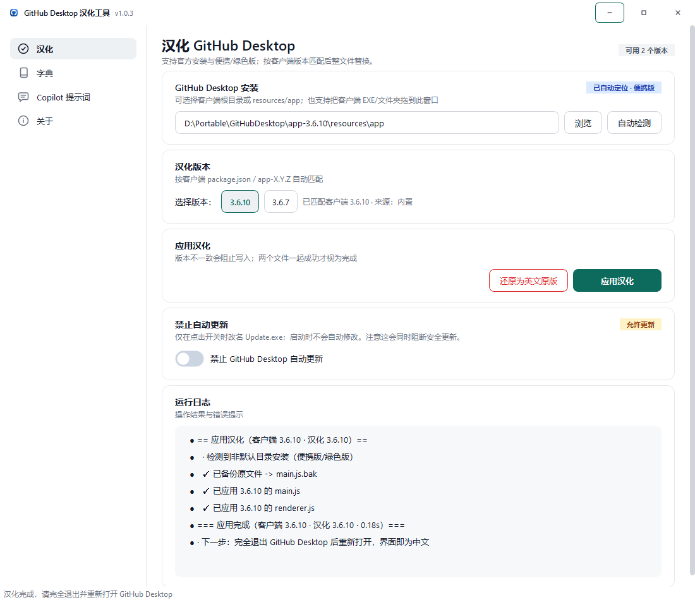

# GitHub Desktop 中文汉化工具

   [](https://github.com/heylumen/github-desktop-zh/releases/latest)

> 一个 GitHub Desktop 中文本地化工具，支持**官方安装与便携/绿色版**。
> 仓库共收录 **22 个版本（3.5.0–3.6.7、3.6.10）**的 Windows 汉化文件。
> 3.5.0–3.6.7 来自 [743859910](https://github.com/743859910/GitHub_Desktop_Simplified_Chinese) 的 MIT 整文件补丁；
> **3.6.10 使用官方同版本底包适配中文字符串**，保留 3.6.10 的程序逻辑。
> EXE 只内置最新 2 版（**3.6.7、3.6.10**），以控制单文件体积；其他版本可在「字典」页**导入**。
> 双击即用，无需安装 Python；工具本身默认不发起网络请求。

> 当前版本：**v1.0.3** · [下载](https://github.com/heylumen/github-desktop-zh/releases/latest) · [更新日志](CHANGELOG.md)



> 界面跟随 Windows 明暗主题，使用中性表面；点击、拖动、窗口切换均不换色。

> 设计与协作规范：[DESIGN.md](DESIGN.md) · [AGENTS.md](AGENTS.md)

⚠️ **免责声明**：本项目与 GitHub, Inc. / Microsoft 无任何关联，非官方产品，未获其背书。
汉化修改仅作用于**你本机已安装的 GitHub Desktop 文件**；Copilot 提示词功能编辑当前用户的全局指令文件，请自行承担使用风险。

---

## 一、汉化补丁来源与 3.6.10 适配

本仓库的 **3.5.0–3.6.7 共 21 个版本**直接使用
[`743859910/GitHub_Desktop_Simplified_Chinese`](https://github.com/743859910/GitHub_Desktop_Simplified_Chinese)
（MIT License，© 2008–2026 743859910 / 我只是你的过客工作室），并已按 MIT 条款保留其版权与许可声明
（见 [LICENSE](LICENSE) 与 [THIRD_PARTY_NOTICES.md](THIRD_PARTY_NOTICES.md)）。

### 收录范围

- **支持平台**：本工具内置 Windows 文件；Linux / macOS 请参考上游项目的手动替换方法。
- **支持版本**：GitHub Desktop **3.5.0–3.6.7、3.6.10**，共 22 个版本。
- **尚未内置**：3.6.8、3.6.9、3.6.11、3.7.0（官方最新为 3.7.0，2026-11-20）。这些版本请下载对应文件后使用「导入汉化包…」。
- ⚠️ **请保持 GitHub Desktop 版本与汉化版本严格一致**。工具会在应用前校验版本，不一致默认阻止写入。

### 3.6.10 的来源与验证方式

`dictionaries/3.6.10/` 以 GitHub 官方 **Windows x64 3.6.10** 安装包中的 `main.js` / `renderer.js` 为底包，移植上游 MIT 许可的中文字符串并补译，保留当前版本的代码结构与执行逻辑。它不是上游提供的 3.6.10 整文件成品；尚未匹配的文案可能保留英文。来源、校验散列和重新生成方法见 [3.6.10 适配说明](docs/3.6.10.md)。

验证包括：JavaScript 语法检查；使用 Acorn 做 AST 比较，**默认拒绝**变量、赋值、返回、比较、对象键、枚举等上下文中的字符串修改，仅允许已审核的显示上下文；校验字典清单散列；在临时目录验证应用、备份、回滚和还原。真实客户端的启动、登录和界面操作仍需人工验证。

### 上游相关链接

| 说明 | 链接 |
|---|---|
| GitHub Desktop 官网 | https://desktop.github.com |
| GitHub Desktop 仓库 | https://github.com/desktop/desktop |
| GitHub Desktop 发行版 | https://github.com/desktop/desktop/releases/latest |
| GitHub Desktop 发行说明 | https://desktop.github.com/release-notes |
| 本工具收录的 GitHub Desktop 版本 | 3.5.0–3.6.7、3.6.10 |
| 当前源码默认打包的汉化版本 | 3.6.7、3.6.10（最新 2 版） |

---

## 二、功能特性

- 🔍 **安装识别**：自动定位官方安装（`%LOCALAPPDATA%\GitHubDesktop\app-*\resources\app`），并记住上次使用的路径；也支持手动选择或拖入**便携版**的客户端 EXE / 根目录 / `resources/app`。
- 🧭 **版本匹配**：优先读取客户端 `package.json`，其次从 `app-X.Y.Z` 路径推断；与所选汉化版本不一致时**阻止写入**，无法识别版本时必须二次确认。
- ✅ **事务式汉化**：先备份 `.bak`，再写同目录临时文件，两个文件全部成功后一次性替换；任一步失败自动回滚，不会留下半中文状态。
- 📦 **多版本导入 + 小体积**：EXE 只内置最新 2 版；其他版本在「字典」页选择下载好的文件夹导入，自动推断版本、创建目录、校验并选中，**无需手工建目录或重启**。
- 🔎 **完整性检查**：内置字典按 `dictionaries/manifest.json` 逐文件 SHA-256 校验；本地字典明确标记为「未验证来源」。
- ↩️ **事务式还原**：从两个 `.bak` 一起还原；缺少任一备份时拒绝执行，避免状态不一致。
- 🚫 **自动更新开关**：只反映本机实际状态，只有点击时才重命名 `Update.exe`；启动时不会自动修改。注意这会同时阻断安全更新。
- 🎨 **跟随系统外观**：明暗主题由 Windows 自动决定，无需手动切换；无边框自定义标题栏，使用中性表面。
- ✍️ **全局 Copilot 提交说明提示词**：读取、编辑并保存当前用户的全局指令，提供中文模板；只改受管区块，自动备份并保留其他指令。
- 🖥️ **命令行版** `cli.py`：`locate / versions / apply / restore / update / import / copilot`，与服务端逻辑同源。

### 界面四页

- **汉化**：安装路径、版本匹配提示、应用/还原、自动更新开关、运行日志
- **字典**：可用版本列表、**导入汉化包…**、打开本地字典目录、检查资源完整性
- **Copilot 提示词**：全局指令路径、编辑提交说明要求、保存/清除、打开目录
- **关于**：版本与支持范围、主要能力、许可与隐私说明、项目主页/字典主页

---

## 三、快速使用

### 1. 直接使用 EXE（推荐）

从 [Releases](https://github.com/heylumen/github-desktop-zh/releases/latest) 下载 `github-desktop-zh-*.exe`，放到任意位置双击。

Release 同时提供官方 **GitHub Desktop 3.6.10 x64** 安装包（未改动，供版本匹配使用）；汉化仍由本工具执行。

1. 点击「自动检测」，或选择客户端根目录 / 拖入 `GitHubDesktop.exe`。便携版没有 `app-X.Y.Z` 层级也可以。
2. 确认版本提示为「已匹配客户端 X.Y.Z」。若提示尚未导入，到「字典」页点击「导入汉化包…」。
3. 关闭 GitHub Desktop → 点击「应用汉化」→ 完成后重新打开客户端。
4. 若安装在 `Program Files` 等需管理员权限的目录，右键「以管理员身份运行」本 EXE。

> ⚠️ 便携版如果只有 `resources\app.asar`（单包封装），本工具不支持直接改写，会明确提示。请改用官方安装包或解包版客户端。

### 2. 命令行版

```bash
python gui/cli.py locate
python gui/cli.py locate --path "D:\Portable\GitHubDesktop"
python gui/cli.py versions
python gui/cli.py apply --version 3.6.10
python gui/cli.py apply --path "D:\Portable\GitHubDesktop"
python gui/cli.py restore
python gui/cli.py update --status
python gui/cli.py update --disable
python gui/cli.py update --enable
python gui/cli.py import --source "D:\Downloads\3.6.11" --version 3.6.11
python gui/cli.py copilot --show
```

- `apply` 默认拒绝版本不一致；确需强制时可加 `--allow-mismatch`（危险）。
- `import` 会自动放入本地字典目录，立即被 `versions` 看到。
- 退出码：`0` 成功，`1` 操作失败或状态异常，`2` 参数/路径错误，适合脚本判断。

### 3. 自行构建

需要 Windows + **Python 3.10–3.13**（PySide6 6.11 要求 `>=3.10,<3.15`）：

```bat
cd gui
build.bat
```

构建脚本会：创建/复用 `build_env` → 校验 Python 版本 → 按 `requirements-build.txt` + `constraints-build.txt` 安装锁定依赖 → 校验字典清单与 JS 语法 → 隐私/self/一致性/对比度/截图门禁 → 打包单文件 EXE → 校验归档 → 无头自检 → 生成 `SHA256SUMS.txt`、`build-info.json` 与 `licenses/`（本地验证产物；Release 只上传 EXE、SHA256SUMS 和选定的官方客户端安装包）。

产物：`gui\dist\github-desktop-zh-1.0.3.exe`（已被 `.gitignore` 忽略）。发布前请按 [docs/release-checklist.md](docs/release-checklist.md) 检查资产、许可与验证结果。

### 4. 开发与测试

```bash
python -m unittest discover -s tests -v
```

- 测试使用临时目录，不写真实 GitHub Desktop 安装目录（GUI 用例使用 offscreen）。
- AST 校验器需要 Node.js 与 Acorn 8.15.0：
  ```powershell
  npm install --prefix .work/js-parser --no-save acorn@8.15.0
  ```
- CI 设置 `GDF_REQUIRE_NODE=1`，禁止 Node 相关测试静默跳过。

---

## 四、更新到未内置的 GitHub Desktop 版本

以官方 3.7.0 为例（需自行准备该版本对应的 `main.js` + `renderer.js`）：

1. 在 GitHub Desktop「帮助 → 关于」确认版本号。
2. 从字典项目或社区获取对应版本的 `main.js` + `renderer.js`。
3. 打开本工具「字典」页 → **导入汉化包…** → 选择该版本文件夹（或其上级/`Windows` 目录）。
4. 工具自动识别版本并导入；无法识别时会要求填写版本号。
5. 回到「汉化」页，版本自动选中，确认匹配后应用即可。

> 安全提示：导入的 JavaScript 会被 GitHub Desktop 执行，只使用可信来源。若需要完全可验证的版本，建议按 [3.6.10 适配说明](docs/3.6.10.md) 自行从官方包生成并校验散列。

---

## 五、原理

1. GitHub Desktop 的界面文案以字符串字面量硬编码在打包后的 `main.js`（进程层）与 `renderer.js`（UI 层）。
2. 3.5.0–3.6.7 使用上游整文件汉化；3.6.10 以官方同版本文件为底包移植中文并保留当前逻辑。
3. 本工具按所选版本，将 `main.js` / `renderer.js` 以事务方式替换到 `resources/app`：
   备份 → 临时文件 → 双文件替换 → 写入备份清单 → 失败回滚。
4. 平台差异：`__DARWIN__` 在 macOS 下使用另一套文案，本工具内置 Windows 成品。

---

## 六、目录结构

```
.
├── README.md / CHANGELOG.md / THIRD_PARTY_NOTICES.md / LICENSE
├── DESIGN.md                     # 设计系统（色彩/字体/间距/组件/反模式）
├── AGENTS.md                     # 构建、架构与协作约束
├── zhpaths.py                    # 安装发现、便携版归一、版本识别（GUI/CLI/zhtool 共用）
├── zhtool.py                     # .zh 词典引擎（apply/scan/merge/verify/watch）
├── dictionaries/                 # 22 版 + manifest.json（内置散列清单）
├── gui/
│   ├── app.py                    # PySide6 图形界面（4 页，跟随系统明暗）
│   ├── theme.py                  # 明暗主题 QSS 与高对比度检测
│   ├── widgets.py                # 自绘导航图标与胶囊开关
│   ├── zhcore.py                 # 核心：事务汉化/还原、更新器状态、字典导入与校验
│   ├── cli.py                    # 命令行版
│   ├── copilot_config.py         # Copilot 全局提交提示词（受管区块/原子写/备份）
│   ├── diagnostics.py            # 本地滚动诊断日志
│   ├── build.bat                 # 可复现构建入口
│   ├── requirements-build.txt    # 直接依赖（锁定）
│   ├── constraints-build.txt     # 传递依赖约束（锁定）
│   └── assets/icon.ico
├── scripts/
│   ├── build_dictionary_manifest.py  # 生成/校验字典散列清单
│   ├── check_dictionaries.py         # 清单 + Node 语法检查
│   ├── check_privacy.py              # 隐私/令牌/本地路径扫描
│   ├── check_self_methods.py         # self 方法静态检查
│   ├── check_consistency.py          # 版本/文档/构建一致性
│   ├── check_contrast.py             # 文字对比度
│   ├── check_visual.py               # 明暗/首页/About 截图回归
│   ├── check_release.py              # tag/clean/hash/dirty 发布门禁
│   ├── verify_archive.py             # EXE 归档内容与编译版本核验
│   ├── smoke_exe.py                  # 打包后无头自检
│   ├── build_release.py              # SHA256SUMS / build-info / licenses
│   ├── build_3_6_10.py               # 从官方包生成 3.6.10 字典
│   └── verify_translation.mjs        # AST 默认拒绝式校验
├── tests/                        # 单元、CLI、GUI、旧引擎、AST 负面夹具；visual/baseline 截图基线
├── docs/                         # 3.6.10、质量门禁、发布清单、故障排查
├── translations/3.6.10.zh
├── licenses/
├── screenshots/
└── .github/workflows/ci.yml      # 静态/隐私/覆盖率/截图 → 构建 → 归档校验 → 产物
```

---

## 七、质量门禁

开发与发布前检查见 [docs/quality-gates.md](docs/quality-gates.md)：

```bash
python scripts/check_privacy.py
python scripts/check_self_methods.py
python scripts/check_consistency.py
python scripts/check_contrast.py
python scripts/check_visual.py
pyright
ruff check .
python -m coverage run --source=gui -m unittest discover -s tests -v
python -m coverage report --fail-under=68
```

## 八、已知限制

- **Windows 专用**；macOS / Linux 请使用上游项目的手动方法。
- **app.asar 单包便携版不支持**。工具会识别并提示，不会尝试破坏性改写。
- 尚未内置 **3.6.8、3.6.9、3.6.11、3.7.0**（官方最新 3.7.0）；请使用导入功能，导入的本地字典无法用内置散列证明来源。
- 3.6.10 中未匹配的文案可能保留英文，这是上游译文覆盖度的限制。
- 「禁止自动更新」会同时阻断**安全更新**，且绿色版可能没有更新器。工具不再在启动时自动禁用。
- 界面颜色稳定，点击、拖动、窗口切换都不会换色。
- 高对比度模式交还系统调色板，保证可读性。
- 明暗主题跟随系统，不提供手动切换；主题切换由 Qt `colorSchemeChanged` 实时响应。
- 自动更新改变 `resources/app` 目录名后，重新「自动检测」即可；`zhtool watch` 也会跟随版本目录。
- 本项目的自动化测试覆盖核心文件操作与 GUI 逻辑，但**不代替**真实客户端的启动、登录、提交与推拉验证。

故障排查见 [docs/troubleshooting.md](docs/troubleshooting.md)。版本变更见 [CHANGELOG.md](CHANGELOG.md)。

---

## 九、致谢与许可

- 汉化内容衍生自 [743859910/GitHub_Desktop_Simplified_Chinese](https://github.com/743859910/GitHub_Desktop_Simplified_Chinese)
  （MIT，© 2008–2026 743859910 / 我只是你的过客工作室）。欢迎给上游点亮 Star ⭐。
- 本项目 [MIT](LICENSE) © 2026 heylumen。
- 第三方组件与分发注意事项见 [THIRD_PARTY_NOTICES.md](THIRD_PARTY_NOTICES.md)。
