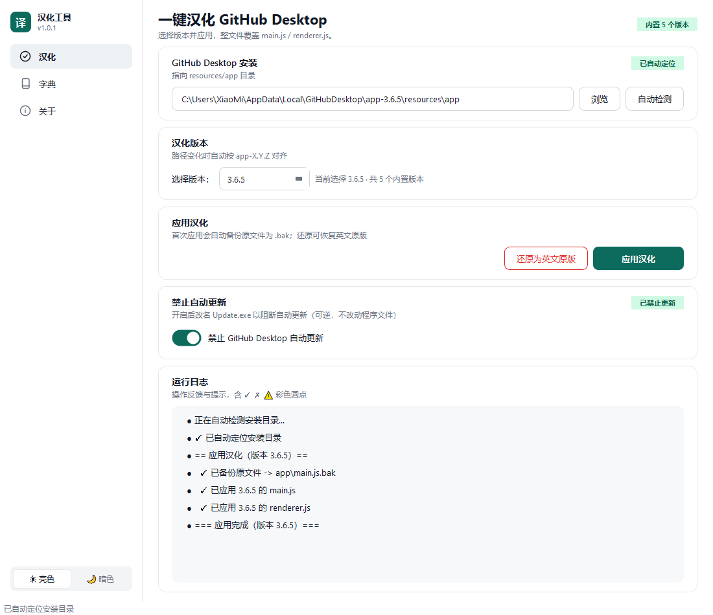

# GitHub Desktop 中文汉化工具

   [](https://github.com/heylumen/github-desktop-zh/releases/latest)

> 一个 GitHub Desktop 中文本地化工具。
> 仓库共收录 **17 个版本（3.5.0–3.6.5、3.6.10）**的 Windows 汉化文件。
> 3.5.0–3.6.5 来自 [743859910](https://github.com/743859910/GitHub_Desktop_Simplified_Chinese) 的 MIT 整文件补丁；
> **3.6.10 使用官方同版本底包适配中文字符串**，保留 3.6.10 的程序逻辑。
> EXE 默认打包最新 5 版（**3.6.2、3.6.3、3.6.4、3.6.5、3.6.10**），其余版本可放入 EXE 同级 `dictionaries/` 目录扩展，
> 双击即用，无需安装 Python、不联网、不自动更新。



⚠️ **免责声明**：本项目与 GitHub, Inc. / Microsoft 无任何关联，非官方产品，未获其背书。
汉化修改仅作用于**你本机已安装的 GitHub Desktop 文件**；Copilot 提示词功能编辑当前用户的全局指令文件，请自行承担使用风险。

---

## 一、汉化补丁来源与 3.6.10 适配

本仓库的 **3.5.0–3.6.5 共 16 个版本**直接使用
[`743859910/GitHub_Desktop_Simplified_Chinese`](https://github.com/743859910/GitHub_Desktop_Simplified_Chinese)
（MIT License，© 2008–2026 743859910 / 我只是你的过客工作室），并已按 MIT 条款保留其版权与许可声明
（见 [LICENSE](LICENSE)）。

### 本工具收录范围

- **项目**：GitHub Desktop 简体中文汉化工具
- **支持平台**：本工具内置 Windows 文件；Linux / macOS 请参考上游项目。
- **支持版本**：GitHub Desktop **3.5.0–3.6.5、3.6.10**，共 17 个版本；未收录 3.6.6–3.6.9。
- ⚠️ **重要**：请保持 GitHub Desktop 版本与汉化补丁版本**严格对应**，否则汉化后可能报错或打不开。

### 3.6.10 的来源与验证方式

`dictionaries/3.6.10/` 以 GitHub 官方 **Windows x64 3.6.10** 安装包中的 `main.js` / `renderer.js` 为底包，移植上游 MIT 许可的中文字符串并补译，保留当前版本的代码结构与执行逻辑。它是本项目对 3.6.10 的适配，不是上游提供的 3.6.10 整文件成品；尚未匹配的文案可能保留英文。来源、校验散列和重新生成方法见 [3.6.10 适配说明](docs/3.6.10.md)。

验证包括：检查两个文件的 JavaScript 语法；对照官方底包核对非翻译内容；确认版本发现和最新五版打包选择；在临时目录验证应用、备份和还原。真实客户端的启动、登录和界面操作仍需另行验证，临时目录检查不能代替客户端运行验证。

### 上游相关链接

| 说明 | 链接 |
|---|---|
| GitHub Desktop 官网 | https://desktop.github.com |
| GitHub Desktop 仓库 | https://github.com/desktop/desktop |
| GitHub Desktop 发行版 | https://github.com/desktop/desktop/releases/latest |
| GitHub Desktop 发行说明 | https://desktop.github.com/release-notes |
| GitHub Desktop 客户端官网下载 | [Linux](https://desktop.github.com) \| [macOS](https://desktop.github.com) \| [Windows](https://desktop.github.com) |
| GitHub Desktop 客户端 Releases 下载 | [Linux](https://github.com/desktop/desktop/releases/latest) \| [macOS](https://github.com/desktop/desktop/releases/latest) \| [Windows](https://github.com/desktop/desktop/releases/latest) |
| 本工具收录的 GitHub Desktop 版本 | 3.5.0–3.6.5、3.6.10 |
| 当前源码默认打包的汉化版本 | 3.6.2、3.6.3、3.6.4、3.6.5、3.6.10 |

> 以上链接便于跳转到官方下载与 Release 页面；版本范围以本仓库实际收录的文件为准。

### 上游手动汉化方法（供参考 / 非 Windows 用户）

> 上游项目采用「把对应平台的 `main.js` / `renderer.js` 拷贝替换到本地 GitHub Desktop 资源目录」的方式：

- **Windows**：复制到
  `C:\Users\【用户名】\AppData\Local\GitHub Desktop\app-【版本】\resources\app`（替换前请务必备份原文件）
- **macOS**：复制到 `/Applications/GitHub Desktop.app/Contents/Resources/app`
- **Linux**：复制到 `/usr/lib/github-desktop/resources/app`

> 本工具（GUI/EXE）已把上述手动步骤**自动化**：自动定位安装目录、一键整文件替换、自动备份与还原，无需手动复制。

---

## 二、功能特性（桌面版 GUI / 单文件 EXE）

- 🔍 **自动定位** GitHub Desktop 安装目录（默认 `%LOCALAPPDATA%\GitHubDesktop\app-*\resources\app`），并自动识别已安装版本。
- ✅ **一键汉化**：在首页**下拉选择版本**（EXE 默认内置 3.6.2–3.6.5、3.6.10 共 5 个；3.5.0–3.6.1 等版本可经本地字典目录扩展），自动备份原文件 `.bak` 后整体替换 `main.js` / `renderer.js`。
- ↩️ **一键还原**：从 `.bak` 恢复英文原版。
- 📦 **多版本内置**：最新 5 个（3.6.2–3.6.5、3.6.10）GitHub Desktop 汉化版本随 EXE 打包；仓库共 17 版，其中 16 版为上游 MIT 整文件补丁，3.6.10 为官方同版本底包的中文字符串适配。工具纯离线、不联网、不自动更新。
- 🔎 **校验内置版本**：在「字典」页可一键校验内置版本的完整性（每个版本均含非空 `main.js` / `renderer.js`）；本地放入的旧版也会一并出现。
- 🧩 **自定义新版本**：当 GitHub Desktop 推出内置尚未覆盖的新版本，可从字典项目下载该版本目录（含 `main.js` + `renderer.js`）放入本地 `dictionaries/<版本>/`，工具自动纳入并优先使用。
- 🚫 **禁止自动更新**：首页「禁止 GitHub Desktop 自动更新」开关默认开启，防止官方自动更新覆盖汉化文件；可随时关闭。
- ✍️ **全局 Copilot 提交说明提示词**：读取、编辑和保存当前用户的全局指令，提供默认中文模板；保存时备份已有文件并保留其他指令。
- 🖥️ 同时提供 **命令行版** `cli.py`（脚本化 / 高级用户）。

### 界面四页

- **首页（汉化）**：自动检测路径 + 版本下拉 + 应用 / 还原 + 自动更新开关
- **字典**：内置版本列表（本地覆盖标记）、打开本地字典目录、校验内置版本、自定义新版本 5 步指引
- **Copilot 提示词**：显示全局文件路径，读取和编辑提交说明提示词、使用默认中文模板、保存或清除本工具管理的提示词
- **关于**：项目主页 + 字典项目主页链接

### 全局 Copilot 提示词

在「Copilot 提示词」页读取已有内容、修改后保存，即可管理当前用户的提交说明偏好。默认文件为 `~/.copilot/copilot-instructions.md`；若设置了 `COPILOT_HOME`，则使用该**绝对路径目录**下的 `copilot-instructions.md`。配置作用于当前用户，不按仓库分别保存。

本工具只管理文件中一个独立的注释区块，保留区块外已有的其他全局指令；修改已有文件前自动生成备份。保存空白提示词或执行清除会删除本工具的区块，保留其他内容。

该文件供支持 Copilot 全局指令的 SDK 生成路径使用。旧 API 路径保持原逻辑，可能不会读取此文件；实际效果取决于 GitHub Desktop 使用的生成路径和账户已启用的功能。

---

## 三、快速使用（桌面版 EXE，推荐普通用户）

### 1. 直接使用（已构建好的 EXE）

从 [Releases](https://github.com/heylumen/github-desktop-zh/releases/latest) 下载最新发布的 `github-desktop-zh-*.exe`（`*` 为版本号，例如 `github-desktop-zh-1.0.1.exe`），放到任意位置双击即可。

EXE 中可用版本以该发布包的「字典」页为准；下文所列五版为当前源码的打包配置。

- 首次运行：点「自动检测」填好路径 → 在「版本」下拉框选择**与你的 GitHub Desktop 完全相同**的版本号 → 点「应用汉化」即可（当前源码默认打包 3.6.2–3.6.5、3.6.10 共 5 个版本；若你的版本未内置，见下方「自定义新版本」放入本地字典）。
- 若 GitHub Desktop 装在 `Program Files` 等需管理员权限的目录，右键「以管理员身份运行」本 EXE 即可。

### 2. 命令行版（cli.py）

```bash
python gui/cli.py locate                      # 自动检测 GitHub Desktop 安装目录
python gui/cli.py versions                    # 源码运行列出全部 17 版，并包含本地扩展版本
python gui/cli.py apply --version 3.6.10      # 应用指定版本汉化
python gui/cli.py apply --path "C:\Users\Me\AppData\Local\GitHubDesktop\app-3.6.10\resources\app"
python gui/cli.py restore                     # 还原为英文原版
python gui/cli.py update --status             # 查看 GitHub Desktop 自动更新状态
python gui/cli.py update --disable            # 禁止 GitHub Desktop 自动更新
python gui/cli.py update --enable             # 允许 GitHub Desktop 自动更新
python gui/cli.py copilot                     # 读取全局受管提示词，等同于 --show
python gui/cli.py copilot --show               # 正文输出到 stdout；路径和状态输出到 stderr
python gui/cli.py copilot --file "prompt.txt"  # 从 UTF-8 文本文件保存提示词（支持 UTF-8 BOM）
python gui/cli.py copilot --preset             # 写入默认中文提交说明模板
python gui/cli.py copilot --clear              # 清除本工具区块，保留其他全局指令
```

`copilot` 的 `--show`、`--file`、`--preset`、`--clear` 互斥。读取时 stdout 只含受管提示词正文，路径和状态写入 stderr；保存结果及生成的备份路径也写入 stderr。空 UTF-8 文件与 `--clear` 的效果相同。此子命令直接使用全局指令路径，无需指定 GitHub Desktop 安装目录。

### 3. 自行打包（源码 → EXE）

需要一台装有 **Python 3.8+** 的 Windows 机器（Qt6 经 PySide6 安装，无需系统 Tk）：

```bat
cd gui
build.bat
```

脚本会：建隔离虚拟环境 → 安装 PyInstaller + PySide6 → 把最新 5 个版本（3.6.2–3.6.5、3.6.10）的 `dictionaries/` 子树
（各含 `main.js` / `renderer.js`）一并打进单文件 → 产出 `gui\dist\github-desktop-zh-x.y.z.exe`（`x.y.z` 为版本号，Windows 专用，约 28 MB，已被 .gitignore 忽略）。
同时可用 `cli.py` 直接跑命令行（无需打包）。

开发验证可运行 `python -m unittest discover -s tests -v`。测试使用仓库内临时配置目录，覆盖全局提示词的内容保留、备份、原子保存与外部修改冲突；已安装 PySide6 时还会检查界面操作和草稿保护。

---

## 四、自定义新版本（当官方发布内置未覆盖的新版）

当 GitHub Desktop 推出新版本（如 3.7.0）而内置尚未覆盖，或你使用的是内置未打包的版本（3.5.0–3.6.1）时：

1. 在 GitHub Desktop 的「帮助 → 关于 GitHub Desktop」中查看你的版本号（如 3.7.0）。
2. 前往字典项目（743859910 仓库）下载 / 适配该版本的 `main.js` + `renderer.js`。
3. 点击工具「打开本地字典目录」，在弹出的 `dictionaries/` 下新建与版本号完全一致的子目录（如 `3.7.0`）。
4. 把 `main.js` + `renderer.js` 放入该子目录，重启本程序。
5. 版本列表会出现该版本并标记「（本地）」，在首页选中即可一键应用（本地优先于内置）。

---

## 五、原理

1. GitHub Desktop 的界面文案以**英文字符串字面量**形式硬编码在打包后的 `main.js`（菜单 / 进程层）与 `renderer.js`（UI 层）中。
2. 3.5.0–3.6.5 采用上游 743859910 的整文件汉化；3.6.10 以官方同版本文件为底包，移植中文字符串并保留当前版本逻辑。
3. 本工具按选定版本，将对应 `main.js` / `renderer.js` **整体替换**到 GitHub Desktop 的 `resources/app`（先备份 `.bak`）。汉化为社区适配，覆盖率取决于对应版本的译文。
4. 平台差异：`__DARWIN__` 在 macOS 下使用另一套文案，故字典按平台分流（本工具内置 Windows 成品）。

---

## 六、目录结构

```
.
├── README.md
├── LICENSE                       # MIT（含本项目与 743859910 双版权声明）
├── github-desktop-zh-*.spec      # PyInstaller 单文件打包配置（文件名含版本号）
├── zhtool.py                     # 底层引擎（自动定位 / 文件解析 / 完整性清单）
├── dictionaries/                 # 共 17 版；EXE 默认打包 3.6.2–3.6.5、3.6.10
│   ├── 3.5.0/ … 3.6.5/          # 16 个版本，来自上游 MIT 整文件补丁
│   ├── 3.6.10/                   # 官方 3.6.10 底包 + 中文字符串适配
│   └── 各目录均含 main.js + renderer.js
├── gui/                          # 桌面版（图形界面 + 单文件 EXE + 命令行）
│   ├── app.py                    # PySide6/Qt6 图形界面主程序（Windows，4 页）
│   ├── cli.py                    # 命令行版（与 GUI 共享 zhcore）
│   ├── copilot_config.py         # 全局 Copilot 提交说明提示词的读取 / 保存 / 备份
│   ├── zhcore.py                 # 无 UI 依赖核心逻辑（多版本应用 / 还原 / 校验 / 本地字典）
│   ├── assets/icon.ico           # 程序图标（官方 GitHub octicon 白猫）
│   ├── build.bat                 # PyInstaller 单文件打包脚本
│   ├── build_env/                # 隔离虚拟环境（.gitignore 忽略）
│   ├── build/                    # PyInstaller 中间产物（.gitignore 忽略）
│   └── dist/                     # 打包产物目录（.gitignore 忽略）
└── screenshots/                  # README 与发布页截图
```

---

## 七、已知限制

- 本工具内置 **Windows** 成品汉化，为 **Windows 专用**；macOS / Linux 用户可直接使用上游项目（743859910）的手动方法。
- 汉化覆盖率取决于对应版本的译文；3.6.10 中未匹配的文案可能保留英文。**请保持 GitHub Desktop 版本与所选汉化版本一致**，否则可能报错或打不开。
- 官方自动更新会覆盖 `resources/app`：首页「禁止自动更新」开关默认开启，可从根源阻断自动更新；若已更新，重新应用一次对应版本即可，「还原」可恢复英文原版。
- 自动更新若改变 `resources/app` 的**目录名**（如 `app-3.6.5` → `app-3.6.10`），重新「自动检测」即可。

---

## 八、致谢

- 汉化内容衍生自 [743859910/GitHub_Desktop_Simplified_Chinese](https://github.com/743859910/GitHub_Desktop_Simplified_Chinese)
  （MIT，© 2008–2026 743859910 / 我只是你的过客工作室）。
- 如果您觉得有用，**欢迎给上游项目点亮一颗 Star ⭐** 以示鼓励！

---

## 许可证

[MIT](LICENSE) © 2026 heylumen · 汉化内容衍生自 © 2008–2026 743859910（我只是你的过客工作室）
